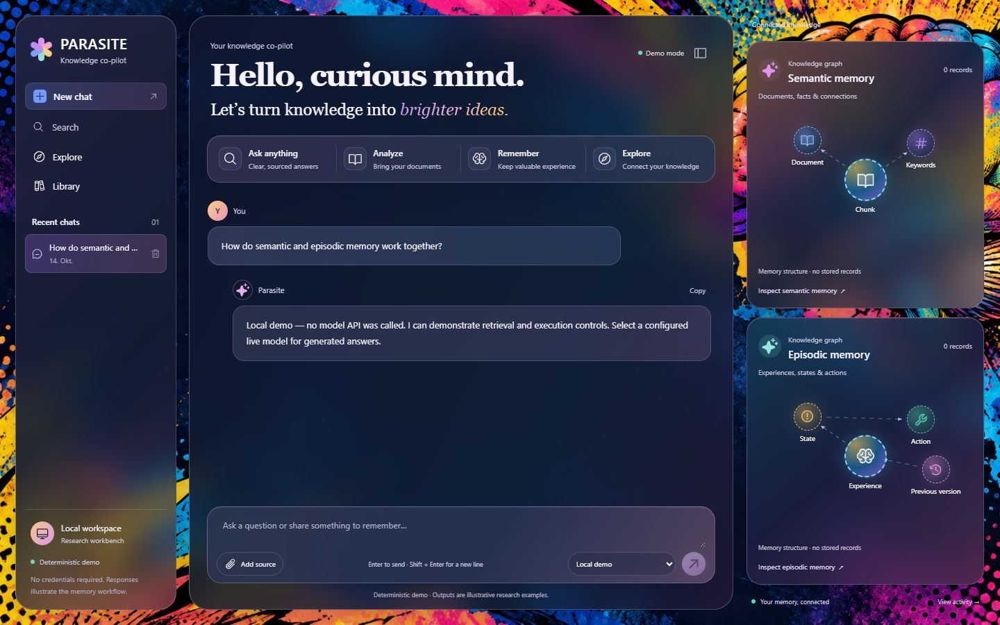
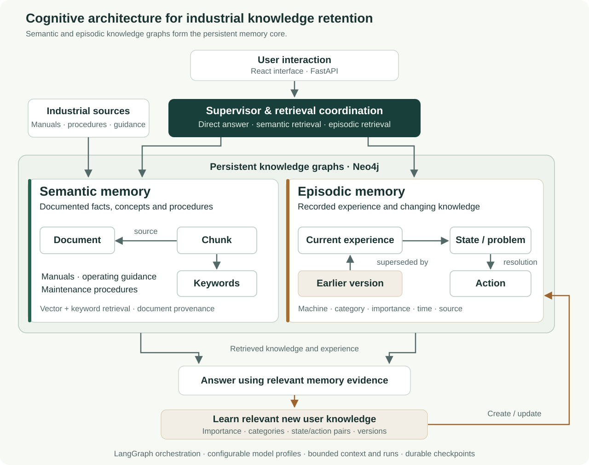

# The Data Parasite

An LLM-based cognitive architecture for retaining industrial knowledge through
**semantic and episodic knowledge graphs**.

Developed in the master's thesis:

> **Cognitive Architecture for Industrial Knowledge Retention: An LLM-Based Agentic Memory Framework**
>
> **Completed: June 2025 (06/2025)**

The framework combines documented industrial knowledge with experience learned
from interactions. Its two memory systems are the central contribution:
semantic memory captures what is known, while episodic memory records what
happened, in which context, and which action was taken.

## Interface



The interface keeps conversations, source evidence and memory relationships
within reach. This screenshot shows the local demo; empty graph panels display
the memory structure until the session contains stored records.

## Architecture



[Open the architecture picture at full size](docs/architecture.svg).

**Neo4j knowledge graphs are part of the core architecture.** They preserve
connections between source documents, chunks, keywords, experiences, observed
states, actions and evolving memory versions. Embeddings help locate relevant
knowledge; graph relationships retain the context needed to interpret and reuse
it. The graph-backed runtime supports both memory systems.

### Semantic memory: documented knowledge

Semantic memory represents factual and conceptual knowledge from sources such
as manuals, maintenance procedures and operating guidance. Its graph model
connects document chunks to their source documents and keywords. Records retain
chunk order and optional page provenance, so retrieved information remains
traceable to its source.

Retrieval combines vector similarity with keyword and content matching. The
supervisor can use this memory when a question needs documented knowledge, such
as an inspection interval or the prescribed maintenance procedure for equipment.
The answer receives the relevant chunks together with their source context.

### Episodic memory: experience and change over time

Episodic memory retains relevant experiences contributed by users. The learning
pipeline separates unrelated information, assigns categories and keywords, and
scores its subjective importance before storing it. Each memory carries a
source and timestamp.

For industrial experience, related **state/action pairs** stay together: the
observed condition or problem, the action or resolution, and the associated
machine. The graph explicitly links the experience to its state and the state
to its recorded action. Missing information remains unspecified rather than
being filled with an invented repair.

When information changes, the framework creates a new memory version and links
the previous version to its successor. Earlier versions remain in the graph;
ordinary retrieval uses current memories. This preserves the development of
knowledge over time instead of replacing an experience with an isolated new
text fragment.

| Memory | Industrial example | Context retained |
| --- | --- | --- |
| Semantic | A maintenance procedure specifies an annual filter inspection. | Source document, chunk, keywords and provenance. |
| Episodic | Pump P1 overheated; an operator cleaned its filter and reported that operation recovered. | Observed state, action, machine, importance, timestamp and memory versions. |

Together, the two systems connect documented practice with recorded experience.
The supervisor chooses direct answering, semantic retrieval, episodic retrieval,
or a response using both. Relevant new user knowledge can then enter the
learning pipeline.

The harness uses LangGraph for orchestration and checkpoints, FastAPI for the
API, and React/TypeScript for the interface. Context, steps, tokens and active
execution time are bounded. Model profiles can be switched independently of the
embedding model, and interrupted runs can be resumed from saved progress.

## Run locally

Clone the repository and install the Python package:

```powershell
git clone https://github.com/vigilanteshit/cognitive-parasite.git
cd cognitive-parasite
uv sync --locked
```

Install and build the frontend before starting the API:

```powershell
npm --prefix frontend ci
npm --prefix frontend run build
```

### Graph-backed memory with Neo4j

Run or connect to a Neo4j instance; see the [Neo4j setup guide](https://neo4j.com/docs/operations-manual/current/docker/introduction/).
Copy the configuration example:

```powershell
Copy-Item .env.example .env
```

Set the following in the local `.env` file using your database credentials:

```dotenv
PARASITE_MEMORY_BACKEND=neo4j
PARASITE_NEO4J_URI=bolt://localhost:7687
PARASITE_NEO4J_USER=neo4j
PARASITE_NEO4J_PASSWORD=replace-with-your-neo4j-password
PARASITE_NEO4J_DATABASE=neo4j
```

The application initializes its graph constraints and vector index. Use a
separate database for this framework. Configure an OpenAI, Azure OpenAI or
Anthropic model profile for LLM reasoning, and a suitable embedding model for
semantic retrieval. See [model configuration](docs/models.md) for role
assignments, credentials, compatibility and reindexing.

Start the application from the repository root:

```powershell
uv run data-parasite serve --host 127.0.0.1 --port 8000
```

Open <http://127.0.0.1:8000>. For frontend development, run
`npm --prefix frontend run dev`. This is a local, single-user application.

### Interface preview without a database service

The default SQLite/demo configuration needs no Neo4j service or model API keys.
It demonstrates the interface, conversation checkpoints and local memory
records. **Use Neo4j for the knowledge-graph functionality.** SQLite is a
convenient interface and development preview, not a substitute for the semantic
and episodic knowledge graphs.

The deterministic demo recognizes explicit statements such as
`I prefer green tea.` and can retrieve ingested text. Live model reasoning
requires a configured provider. Keep credentials in environment variables or a
local, untracked `.env` file.

## Research foundations

The thesis was inspired by:

- [GraphRAG: From Local to Global](https://arxiv.org/abs/2404.16130) — graph-backed retrieval and connected knowledge.
- [Cognitive Architectures for Language Agents (CoALA)](https://arxiv.org/abs/2309.02427) — modular memory, actions and decision-making.
- [Generative Agents](https://arxiv.org/abs/2304.03442) — experience storage and retrieval over time.

These are conceptual inspirations; the framework has its own memory model and
implementation. [Research and design](docs/research.md) explains the connection
and discusses related MemGPT and A-MEM work.

## Project layout

- `src/data_parasite/` — supervisor, memory services, model adapters, persistence and API.
- `frontend/` — React and TypeScript research interface.
- `docs/` — architecture picture, [model configuration](docs/models.md), [memory implementation details](docs/core-preservation.md), research context and publication guidance.
- `scripts/audit_publication.py` — source and history audit for public releases.
- `scripts/evaluate.py` — synthetic retrieval regression without external API calls.
- `scripts/verify_neo4j.py` — real graph and vector operations against a disposable Neo4j service.

## Verify

```powershell
uv run pytest
uv run python scripts/evaluate.py
npm --prefix frontend test
```

The synthetic evaluation compares retrieval with a naive lexical baseline.
Provider contracts are tested offline; CI also checks a real disposable Neo4j
service and browser flows. Paid-model quality, cost and account compatibility
require separate evaluation with configured credentials.

## Citation and license

If you use this work, cite it using [CITATION.cff](CITATION.cff). The project uses
the MIT License; see [LICENSE](LICENSE).
