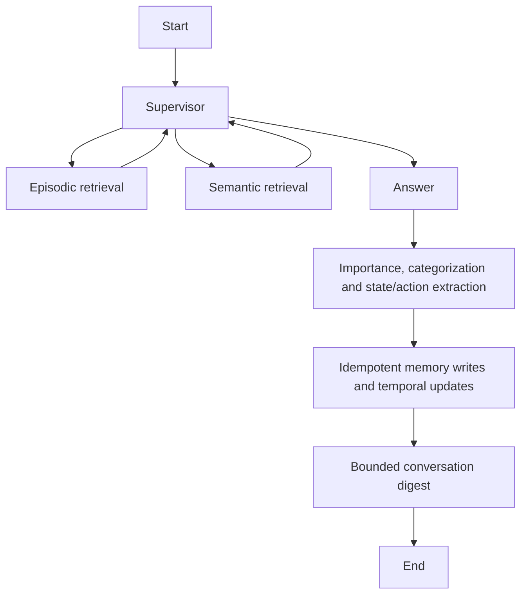

# Core memory behavior and durable execution

The new core preserves the thesis prototype's supervisor, semantic memory, episodic memory, and temporal updates. It does not import or execute the original modules: their import-time database clients, credential loading, transcript files, and logging are unsuitable for a clean application boundary.

## Mapping the original implementation

| Original behavior and evidence | Current implementation |
| --- | --- |
| `graphs/chatbot.py:node_supervisor` selects direct answer, episodic retrieval, semantic retrieval, or final answer | `harness.SupervisorDecision` and the LangGraph `supervisor` node expose the same four actions. A validated optional standalone search query resolves references using bounded recent conversation and summary. |
| `graphs/chatbot.py:node_final_answer` combines both kinds of memory and prefers recent episodic facts | The answer node combines current episodic facts with semantic document chunks. Episodic evidence is newest first; semantic evidence preserves document and chunk order, page, and source. Legacy versions remain inspectable but are excluded from ordinary retrieval. |
| `graphs/episodic_memory.py:node_hippocampus_agent` scores subjective importance | Extraction gives each fact a validated importance in `[0,1]`; the configured threshold gates writes. Unimportant chat produces no records. The prototype's `>=0.0` gate admitted every score; the new default threshold is `0.1`. |
| `graphs/episodic_memory.py:node_cunk_on_memory_agent` separates independent facts while keeping related career information together | The extraction contract explicitly separates unrelated facts and keeps a career problem/resolution together. The array is limited to 16 facts per turn. |
| `graphs/episodic_memory.py:node_inside_box_agent` assigns `health`, `relationships`, `career`, `personal`, `other` and keywords | Those five categories are retained as validated literals. Keywords remain attached to records and participate in retrieval. |
| `graphs/episodic_memory.py:create_state_action_pairs` creates state description, action steps, machine, and keywords; uses `NP` when information is absent | Career records preserve state, action, machine and keywords together. A missing counterpart becomes `NP`; the prompt prohibits inventing a repair. Neo4j additionally materializes `DPState` and `DPAction` linked with `RESOLVED_BY`. |
| `graphs/episodic_memory.py:node_drop_table_agent` and `utils/neo4j_helper.py:handle_memory_operation` choose create/update and mark old knowledge legacy | Explicit changed facts identify a retrieved same-category fact through `supersedes`. SQLite uses one immediate transaction; Neo4j uses one managed write transaction with a lock on the predecessor. The old fact becomes legacy, the new record carries `supersedes`, and the old record carries `superseded_by`. Neo4j also writes `SUPERSEDED_BY`. Competing changes reject an already superseded predecessor. |
| `utils/memory_retrieval.py` combines vector and keyword retrieval, expands career state/action context and tracks retrieval counts | Both backends combine lexical keywords/content with vector similarity and return the complete paired career record. Retrieval counts are maintained. Candidate and output limits constrain all searches; no full keyword/document catalogs are injected into prompts. |
| `direct_scripts/semantic_memory_integration.py` associates document chunks with keywords, pages and embeddings | Semantic records retain document, page, chunk order, keywords, embedding identity and original source. Neo4j creates document and keyword relationships. File ingestion lives outside the harness. |

The original six episodic vector indexes are consolidated into a single record embedding over content, state, action, and keywords. Retrieval still yields the full pair rather than an isolated state or action. This is a deliberate storage change, not a migration of the original database. Existing records require an explicit export/transform/reindex workflow; changing embedding settings never silently mixes old and new vectors.

## A canonical execution trace

For a user who says “Pump P1 overheated; I cleaned its filter”, a live supervisor can choose episodic retrieval, return to the supervisor, optionally retrieve semantic manual evidence, and generate an answer using both. Extraction then stores an observed career record such as state “Pump P1 overheated”, action “Cleaned its filter”, machine “P1”, and source `user:<run-id>`. The assistant's generated advice is excluded from extraction.

For “I live in Berlin” followed by “I now live in Vienna”, the second extraction sees the first record as evidence and can name its ID in `supersedes`. The update transaction creates a new current record and marks Berlin legacy. Normal retrieval returns Vienna. Listing with `include_legacy=True` retains both versions and their provenance. The same memory IDs in a different session remain independent.

The graph is:

## Limits, restart, and cancellation

Every model call, including supervisor and extraction, passes through the same context builder. Mandatory instructions, structured schema, and the latest user message must fit intact. Complete evidence records and newest history are added only as space permits; omission counts appear in context events. Evidence and summaries use explicitly delimited user-role messages governed by system instructions, never system-role document text.

Accounting uses one UTF-8 byte per token as a conservative upper bound plus message/schema overhead. Output capacity is reserved before a request. The provider's maximum internal attempts multiply the reservation; failed requests still consume their reservation. Actual reported input/output usage is recorded separately. This trades some context capacity for predictable limits without tokenizer downloads or provider-specific assumptions.

Step and reserved-token counters persist for the entire run, including resumed attempts. A limited run therefore requires an explicit limit increase before it can continue; repeatedly clicking resume cannot replenish its budget. Active execution time also persists across normal resumes; server downtime is excluded. Unexpected process termination cannot record the final in-flight duration, so crash recovery retains the last persisted elapsed time while the durable step and token budgets remain enforced. Cancellation races the active provider or memory operation against an event and cancels that task immediately. Streamed model output is never retried automatically after a token has been delivered.

Each run has a stable LangGraph thread ID derived from its session and run IDs. `AsyncSqliteSaver` persists node checkpoints synchronously. Resume invokes pending checkpoint work, retains completed node results, and keeps the original run ID. Message writes use unique `(run_id, role)` keys. Memory IDs are deterministic for a run's extracted facts, so a partially completed write node can repeat without creating extra records. External model calls interrupted before a checkpoint may be repeated and incur cost; the budget reserves them before dispatch.

Run leases prevent concurrent execution within a session. `recover_interrupted()` clears leases only at startup of the documented single-worker application after the previous worker has stopped. A deployment with multiple workers needs coordinated recovery instead of calling that method indiscriminately.

Events contain phases/actions, token text, retrieval IDs/sources, budget counters, memory operation IDs, and safe error codes. Supervisor reasoning is neither requested nor emitted. Retrieval failures are reported as `memory_unavailable`, distinct from a successful search with zero results. A failed learning phase preserves a completed answer in the run record and its graph checkpoint, while the assistant transcript message is written once the run completes.

Session deletion removes every run, message, event, graph checkpoint and session digest. The caller first stops active work and deletes the session's long-term memories. Bulk memory deletion does not inherit public listing limits.

## Validation and limits of evidence

Deterministic tests cover importance-compatible career pairing, persisted supersession, conflicting temporal updates, cross-session isolation, idempotent runs, bounded retrieval, embedding mismatch, context overflow, repeated supervisor actions, explicit retrieval errors, provider error sanitization, interrupted calls, restored checkpoints, persistent limits and complete privacy deletion. Neo4j adapter tests verify bounded parameterized keyword/vector query construction and typed connection failures using an injected driver. A live Neo4j server and paid model calls are not part of these offline checks; deployment must validate those integrations with its chosen versions and credentials.

The local SQLite backend combines a bounded recent vector candidate pool with independently scoped lexical candidates, and Neo4j vector candidates are drawn from a bounded shared index before session filtering. Both preserve isolation, but an older fact or a small session may receive fewer candidates. Keyword retrieval provides an independent scoped path. This application is intended for a single-user local deployment; internet-facing identity, authorization, multi-worker recovery and stronger retrieval guarantees require additional infrastructure.

The implementation follows [LangGraph persistent checkpoints](https://docs.langchain.com/oss/python/langgraph/persistence), [Neo4j managed transactions and query parameters](https://neo4j.com/docs/python-manual/current/transactions/), and [Neo4j vector indexes](https://neo4j.com/docs/cypher-manual/current/indexes/search-indexes/vector-indexes/).
